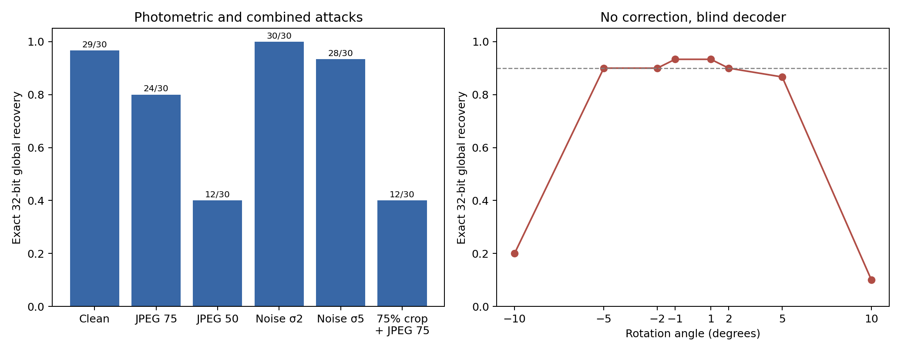

# Robust Localized Image Watermarking with Hierarchical Error Control

This Computer Vision course project embeds an invisible 32-bit identifier into ordinary images and evaluates recovery after cropping, JPEG compression, Gaussian noise, and rotation. The final system combines the official pretrained **Watermark Anything (WAM)** localized watermark model with a small error-correcting code, integrity filtering, and spatial repetition.

The evidence supports useful robustness to mild noise and small rotations, but the final validation is deliberately classified **LIMITED**: JPEG Q50, approximately 10° rotation, and crop plus JPEG remain difficult. These results come from a small screening set and are not a population-level or state-of-the-art claim.

## Final method

```text
32-bit global payload
        ↓ split into A, B, C, D (four bytes)
spatial repetition [A, B, C, D, D, C, B, A]
        ↓ one packet per localized region
3-bit packet ID + 8-bit data + 5-bit CRC = 16 bits
        ↓ BCH(31,16), t=3 + one overall parity bit
32-bit local WAM message
        ↓
official localized WAM embedding and blind detection
```

- **Localized WAM** embeds eight independently detectable messages into fixed, non-overlapping image regions. WAM is an upstream project; it was not created in this repository.
- **BCH(31,16), t=3 plus parity** repairs the small local bit errors observed in clean WAM decoding. The extra parity bit extends the transmitted codeword to the 32 bits expected by WAM.
- **CRC-5** uses `g(x) = x^5 + x^2 + 1` (`0x25`, initialization 0, no reflection, final XOR 0) to reject packets that decode beyond the BCH guarantee.
- **Spatial repetition** stores each source byte twice in the layout `[A,B,C,D,D,C,B,A]`, allowing a missing localized region to be treated as an erasure.

The design trades capacity for robustness: eight 32-bit WAM messages carry one 32-bit global payload, an 8:1 embedded-to-useful bit ratio.

## Why this design

The original uncoded four-region baseline recovered 112/120 exact packets; its eight failed packets were localized but contained 1–3 incorrect bits. In a subsequent BCH-protected run, the same received messages yielded 115/120 exact raw codewords before correction and 120/120 exact useful payloads after correction. These are different comparisons and payload capacities. BCH-only crops then produced 8/720 silent wrong decodes, motivating CRC filtering. Spatial repetition supplies a second copy when a source byte is erased.

An outer MDS(8,4) code was also tested against a strong repetition baseline under identical embedding budgets. Across 180 paired blind crops, MDS recovered 162 global payloads and repetition recovered 161. The one-case difference did not meet the predeclared improvement gate, so the simpler repetition scheme was retained. MDS is not part of the final method.

## Historical measured results

The archived final robustness run used 10 public natural images, 3 deterministic payload seeds per image, and 8 localized packets per marked image.

| Condition | Exact 32-bit global recovery |
|---|---:|
| Clean | 29/30 (96.7%) |
| Gaussian noise σ=2 | 30/30 (100.0%) |
| Gaussian noise σ=5 | 28/30 (93.3%) |
| JPEG Q75 | 24/30 (80.0%) |
| JPEG Q50 | 12/30 (40.0%) |
| Rotation −1° / +1° | 28/30 / 28/30 (93.3%) |
| Rotation −2° / +2° | 27/30 / 27/30 (90.0%) |
| Rotation −5° / +5° | 27/30 / 26/30 (90.0% / 86.7%) |
| Rotation −10° / +10° | 6/30 / 3/30 (20.0% / 10.0%) |
| ~75% arbitrary crop + JPEG Q75 | 12/30 (40.0%) |

Mean clean marked-image quality was approximately **41.0 dB PSNR** and **0.980 SSIM**. No complete false global payload was produced on the 10 unmarked negative-control images. The negative control is a sanity check, not a formal false-positive estimate.



Full interpretation and limitations are in the [final validation report](validation_wam_final_robustness_20261008/FINAL_VALIDATION_REPORT.md). Machine-readable final results are in [summary.json](validation_wam_final_robustness_20261008/results/summary.json), [cases.csv](validation_wam_final_robustness_20261008/results/cases.csv), and [packets.csv](validation_wam_final_robustness_20261008/results/packets.csv).

## Repository map

- `src/watermarking/`: importable package — error-control codecs (`codec/`), WAM wrapper (`wam/`), attacks, metrics, data loading, eval, and the CLI/web pipeline.
- `experiments/`: runnable entry points — `baseline/`, `inner_ecc/`, `hierarchical/`, `robustness/`, `ablation/`.
- `tests/`: codec verification and regression tests; exhaustive packet injections through weight six can take time.
- `validation_wam_*/`: four historical evidence directories, retaining protocols, reports, CSV/JSON results and selected figures. The first uses `official_results/`. New runs write under `experiments/`; only part of the original staged workflow has been migrated. See the [migration map](docs/RESEARCH_HISTORY.md).
- [docs/WORKFLOW_ZH.md](docs/WORKFLOW_ZH.md): detailed Chinese runbook, experimental reasoning and archive policy.
- [docs/RESEARCH_HISTORY.md](docs/RESEARCH_HISTORY.md): provenance, migration coverage and audit findings.
- `src/pilot.py`, `src/offline_backend.py`, and `EXPERIMENT_PLAN.md`: earlier DWT/DCT synthetic pilot retained as project history; its results are not presented as WAM evidence.

Large local environments, the upstream WAM checkout, raw logs, caches, and downloaded model weights are intentionally excluded from Git.

## Setup

The verified local run used Python 3.10.14, PyTorch 2.5.1, Torchvision 0.20.1, NumPy 1.26.4, Pillow 10.4.0, and scikit-image 0.24.0. CPU execution was used on macOS arm64; upstream WAM also documents a CUDA/Linux configuration.

Create an environment and install the pinned direct dependencies:

```sh
python3.10 -m venv .venv
. .venv/bin/activate
python -m pip install --upgrade pip
python -m pip install -e ".[dev]"
```

`pyproject.toml` installs the package, `wm` CLI, web dependencies and development tools; `requirements.txt` retains the historical scientific dependency pins and is not sufficient by itself for the current package. Existing local installations only need environment activation.

Clone the official WAM repository at the exact validated commit. The clone remains untracked by this project:

```sh
git clone https://github.com/facebookresearch/watermark-anything.git \
  validation_wam_20261007/watermark-anything
git -C validation_wam_20261007/watermark-anything checkout \
  2c08af04d037d5667c02f6ddebbda9ff04581c3e
mkdir -p validation_wam_20261007/watermark-anything/checkpoints
curl -L https://dl.fbaipublicfiles.com/watermark_anything/wam_mit.pth \
  -o validation_wam_20261007/watermark-anything/checkpoints/wam_mit.pth
```

Verify the checkpoint before running it:

```sh
shasum -a 256 validation_wam_20261007/watermark-anything/checkpoints/wam_mit.pth
```

Expected SHA-256:

```text
90ef232384e023bd63245eb0c131abd69d2afc7b8f17a71ccedceb542bf009e2
```

The 360 MB checkpoint is ignored and must not be committed. The pinned checkout also supplies `checkpoints/params.json`. For another checkout location, set `WAM_PATH` (for example `export WAM_PATH="$PWD/third_party/watermark-anything"`). Current runners use CPU and do not train or fine-tune WAM.

The dataset loader prefers bundled scikit-image samples, then uses the pinned scikit-image fetcher/cache. Missing samples may require network access and `python -m pip install pooch`. Prepared inputs and their SHA-256 hashes are saved per experiment.

## Run the current code

All commands below run from the repository root after `source .venv/bin/activate`.

```sh
python -m pytest
wm embed input.png marked.png --payload 0x12345678
wm detect marked.png --json
```

Embedding converts to RGB and center-crops/resizes to **512×512**, matching the fixed region layout; it does not preserve arbitrary original dimensions. Use PNG for the initial output. Detection takes only the marked/attacked pixels, preserving the input dimensions. A successful example payload prints as decimal `305419896`; recovery is not guaranteed for every image. The file round trip includes 8-bit quantization, whereas the experimental clean condition detects the in-memory marked tensor.

Optional web interface (model loaded once):

```sh
python -m uvicorn watermarking.web:app --host 127.0.0.1 --port 8000
```

Open <http://127.0.0.1:8000/docs> for `/embed`, `/detect`, and `/health`.

### Final robustness measurements

For a **fresh run**, choose a new output directory:

```sh
python experiments/robustness/run.py --output-dir output/robustness-run-01
python experiments/robustness/finalize.py --output-dir output/robustness-run-01
```

This generates `results/`, `figures/`, and `logs/` below that directory. The run evaluates 30 image/payload combinations × 14 conditions = 420 cases, plus 10 unmarked controls. It records 3,360 region rows. The default directory is `experiments/robustness/`; existing CSVs are refused unless reuse is explicitly requested. Partial runs are not automatically resumed.

To reaggregate existing complete CSVs without model inference:

```sh
python experiments/robustness/run.py --reuse
python experiments/robustness/finalize.py
```

Reuse checks file row counts; it does not certify that CSVs were produced by the current source, weights or environment. An isolated output directory is the recommended way to measure code changes. The inverse-angle search described in the historical protocol is not implemented here: if its trigger fires, the runner stops after saving baseline results instead of claiming completion.

The compatibility wrapper accepts a run directory and an optional `--reuse`:

```sh
sh validation_wam_final_robustness_20261008/REPRODUCE.sh output/robustness-run-02
```

### Earlier experimental questions

```sh
python experiments/baseline/run.py       # clean 2 → 4 → 8 region screening
python experiments/inner_ecc/run.py      # four-region BCH clean experiment
python experiments/hierarchical/run.py   # paired repetition/MDS blind crops
python experiments/ablation/run.py       # repetition/MDS on clean and JPEG75
```

These runners prepare their own inputs, write under their respective `experiments/<name>/` directories, and overwrite their generated results. They are independent entry points, not a pipeline that consumes the previous command's output. The research rationale is sequential, but running these four commands does **not** replay every historical prerequisite phase. In particular, BCH-only crops, four-region CRC crops and independent eight-packet feasibility remain archived evidence rather than current standalone runners. `ablation` is an outer-code comparison, not a full BCH/CRC removal study.

Keep historical reports tied to their historical measurements; do not replace their numbers with fresh runs without identifying the new experiment. See [research history](docs/RESEARCH_HISTORY.md) for the original source revision and exact migration coverage.

## Limitations

- JPEG Q50 remains difficult, and even JPEG Q75 recovered only 80% of global payloads in the final run.
- Approximately 10° rotation sharply reduces recovery; no rotation-correction module was added.
- Combining arbitrary cropping with JPEG Q75 recovered only 40% of global payloads.
- The global useful payload is 32 bits, while the physical embedding budget is 256 WAM bits.
- The evidence uses only 10 images and 3 payload seeds per image.
- CRC-5 is an error-detection check, not cryptographic authentication.
- No state-of-the-art, production-security, or population-level claim is made.

## Upstream attribution

This project uses the official [facebookresearch/watermark-anything](https://github.com/facebookresearch/watermark-anything) implementation and the official `wam_mit.pth` checkpoint, pinned to commit `2c08af04d037d5667c02f6ddebbda9ff04581c3e`. WAM and its checkpoint remain subject to their upstream licensing and attribution terms. This repository does not vendor the upstream source, Git history, or model weights.

No license has been assigned to this course-project repository.
